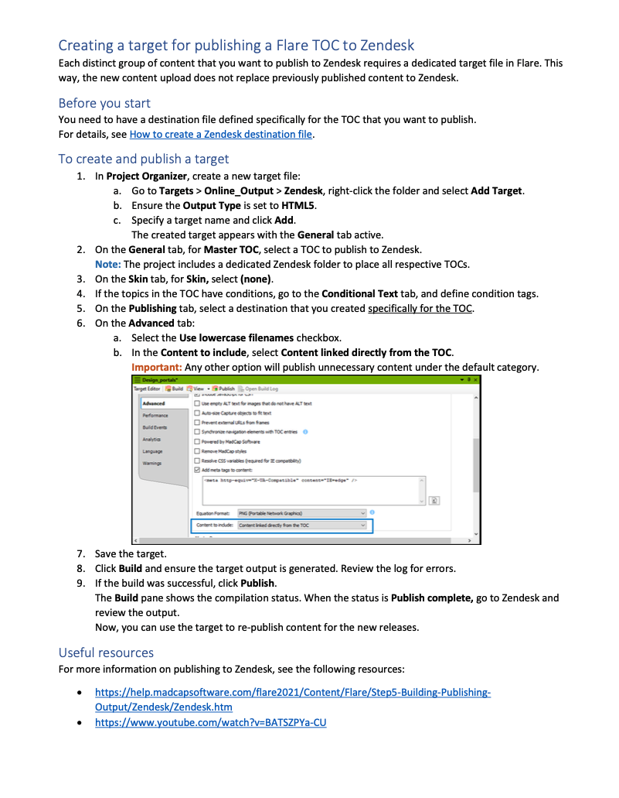

This how-to guide, originally written in the pre-AI era, details our internal workflow for publishing from MadCap Flare to Zendesk. I documented this process to ensure the instructions reflect our environment.

