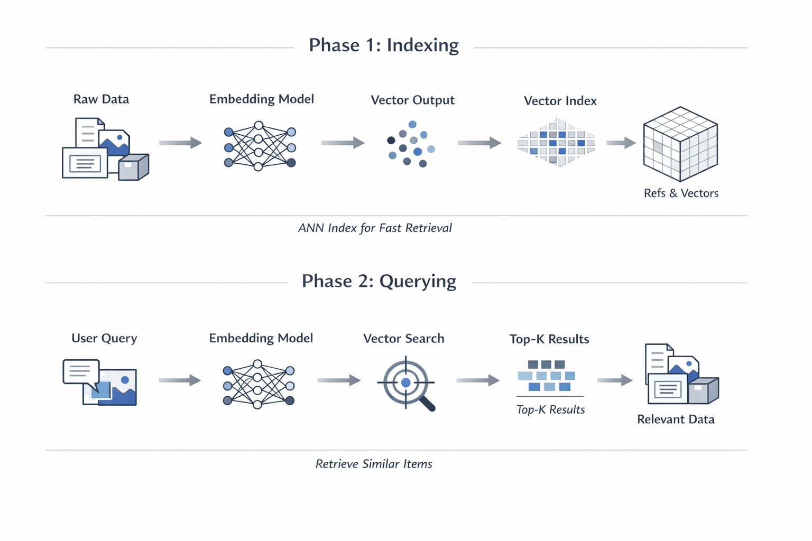

A vector search system operates in two phases: indexing and querying.



## Phase 1: Indexing

During indexing, the system prepares the data for fast search.

1. An embedding model processes the input data, such as documents, images, or products.  
2. The model converts each item into a vector.  
3. The system stores the vectors and references to the original data in an index.  
4. The system optimizes the index with an approximate nearest neighbor (ANN) algorithm.  

## Phase 2: Querying

During querying, the system finds the most similar items.

1. The same embedding model processes the user query, such as text, an image, or other input.  
2. The model converts the query into a vector.  
3. The system compares the query vector with the stored vectors.  
4. The system finds the top *k* most similar vectors.  
5. The system returns the original data for those vectors.  

## Pipeline summary

A vector search system usually follows this pipeline:

```
Data → Embedding model → Vector index → ANN search → Top-k results
```