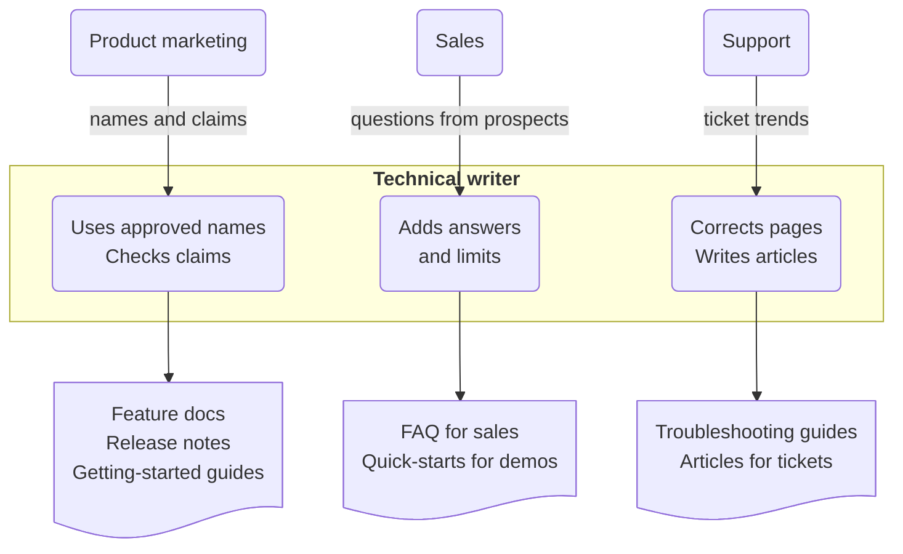

In the past, technical writers worked mostly with engineers and product managers. Their work was at the end of the product process. In 2026, the job includes more of the customer journey. It starts at the launch page that a prospect (a possible customer) reads. It stops at the ticket that a support agent closes.

## Why the job becomes wider

Three changes occur at the same time.

First, writers speak with engineers less frequently. API writer Tom Johnson often learns about new releases from code diffs. Now, his meetings with engineers and product managers are mostly for the approval of release notes ([The emerging picture of a changed profession](https://idratherbewriting.com/blog/cyborg-model-emerging-talk)). Writers can now use this time for other teams.

Second, writers work with more teams outside engineering. You can see this change in three areas:

- **Product marketing and sales enablement** — job postings ask for product marketing and sales enablement content. They ask for this content together with manuals, API docs, and release notes.
- **Pre-sales** — in the past, companies used writers only after the sale. Alex Fiedler of Torq says that writers can also write content that buyers use to make a decision ([Document360 webinar](https://document360.com/webinar/role-of-technical-writers-in-product-experience/)).
- **Support and training** — job postings show support as a usual partner team. Chatbot logs also show writers the sentence that a page did not have ([How technical writers use chatbot analytics to improve docs](https://biel.ai/blog/technical-writers-ai-chatbot-analytics-documentation-quality)).

Third, buyers read the docs. The State of Docs 2026 survey had 1,131 participants. Of these participants, 88% said that documentation is important when they buy a product ([Documentation as infrastructure: key takeaways from State of Docs 2026](https://www.drexplain.com/press/articles/documentation_as_infrastructure_key_takeaways_from_state_of_docs_2026/)). Prospects read the docs before they buy. Because of this, the docs are also important to marketing and sales.

AI now writes more first drafts. Because of this, your most important tasks change. You must verify the content, give it a structure, and connect it to other content. This verification is most important for marketing, sales, and support content, because customers read it directly.

:::note

Most of this data comes from job postings, conference talks, and vendor blogs. It shows what employers ask for. It does not show what all writers do at this time.

:::

## Collaboration outside engineering and product

Engineering and product are still the most important teams. They tell you how the product operates and what the next release contains. These notes are about three more teams:

- **[Product marketing](./product-marketing.md)** — tells you how the company presents the product. This team also owns the names and claims that customers see first.
- **[Sales](./sales.md)** — tells you the questions that prospects ask before they buy. During calls with customers, this team needs quick and correct answers.
- **[Support](./support.md)** — tells you the problems that users have after they buy. This team has the ticket data that shows where the docs fail.

You collect this information from all three teams. Then you use it to write documentation for the full customer journey. In the diagram, each column shows the flow for one team. The teams are at the top, the writer is in the middle, and the docs for each team are at the bottom.

## Collaboration tips

Use these tips with product marketing, sales, and support:

1. **Make a shared glossary and style guide.** Then the website, the docs, and the UI use the same name for each feature. For when to make the glossary, see [Work in each launch phase](./product-marketing.md#work-in-each-launch-phase).
2. **Learn about releases early.** Attend product planning meetings or release meetings. Then all teams know about changes in time.
3. **Make one procedure for doc requests.** Use a form or a ticket template. Do not accept requests in many different direct messages.
4. **Have short meetings at regular intervals.** Do not speak with the teams only when a request comes in.
5. **Use these teams as reviewers and as sources of information.** Each team knows things about users that engineers frequently do not know.
